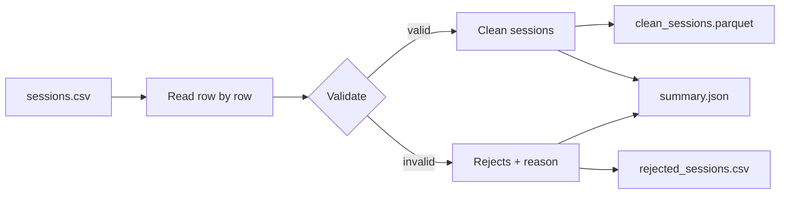

# EV Charging Report

A batch data pipeline that validates nightly charging-session files from electric-vehicle charging stations and produces a per-station energy report, a typed Parquet dataset of clean sessions, and an auditable reject log.

## Business context

Each charging station exports a nightly CSV of charging sessions. These files regularly contain defects: blank station IDs, unparsable timestamps, sessions that end before they start, non-numeric or out-of-range energy readings, and duplicated session IDs.

Operations needs two things from every file:

1. **Accurate totals** — energy delivered (kWh) and session count per station, calculated from valid sessions only.
2. **Traceable rejects** — every rejected row, with its original line number and a machine-readable reason, so issues can be raised with station owners.

This pipeline delivers both, and a single bad row never stops the run.

## Architecture



Each row passes through a chain of checks. The first failing check determines the reject reason; rows that pass every check are parsed into typed values (`datetime`, `Decimal`) and collected for output.

| Stage | Responsibility |
|---|---|
| `field_check` | All expected columns are present and populated |
| `blank_check` | No field is empty or whitespace-only; values are stripped |
| `parse_session` | Timestamps parse as ISO 8601, end is after start, kWh is a finite number within range |
| Duplicate check | A `session_id` already used by an earlier accepted row is rejected (first occurrence wins) |

## Validation rules

| Rule | Reject reason |
|---|---|
| An expected column is missing from the file header | `missing_field` |
| A row has fewer values than the header (truncated row) | `missing_<field>` |
| A field is blank | `blank_<field>` |
| `start_time` or `end_time` is not a valid ISO timestamp | `unparsable_time` |
| `end_time` is not after `start_time` | `end_not_after_start` |
| `kwh` is non-numeric, non-finite (`nan`, `inf`), `<= 0` or `> 150` | `kwh_is_invalid` |
| `session_id` already used by an earlier accepted row | `duplicate_session` |

## Outputs

| File | Format | Contents |
|---|---|---|
| `clean_sessions.parquet` | Parquet | Valid sessions with an explicit schema: timestamps as `timestamp(us)`, kWh as `decimal128(10, 2)` |
| `summary.json` | JSON | Sessions and total kWh per station, plus valid and rejected row counts |
| `rejected_sessions.csv` | CSV | `line_number`, `session_id`, `reason` for every rejected row |

Example `summary.json` from the sample data:

```json
{
  "stations": {
    "A": {"sessions": 2, "kwh": 19.5},
    "B": {"sessions": 1, "kwh": 20.25},
    "C": {"sessions": 1, "kwh": 11.0}
  },
  "valid_rows": 4,
  "rejected_rows": 8
}
```

## Design decisions

- **`Decimal` for energy values.** kWh is summed with `Decimal` rather than `float` to avoid binary rounding drift in totals.
- **Reject, don't crash.** Row-level problems are recorded and the run continues, so one faulty station export cannot block the whole report.
- **Row reconciliation.** Every run asserts that `rows_in == valid_rows + rejected_rows`, so no row can be silently lost.
- **Original line numbers in rejects.** Line numbers refer to the source file (header = line 1) so rejects can be located directly in the station's export.
- **Explicit Parquet schema.** The clean dataset carries real types instead of strings, so downstream consumers do not need to re-parse it.
- **Configuration over hard-coding.** Input and output paths live in `config.json`, keeping code unchanged across environments.
- **Separation of concerns.** `cleaning.py` contains validation and output logic; `pipeline.py` handles configuration, orchestration and logging.
- **Plausibility limit on kWh.** Sessions above 150 kWh are rejected as likely meter or export errors. This threshold is a business rule, not a physical limit, and should be reviewed with operations as larger-battery vehicles become common.

## Project structure

```
ev-charging-report/
├── config.json
├── pyproject.toml
├── data/
│   └── sessions.csv
├── output/  # created on run (git-ignored)
├── ev_charging_report/
│   ├── __init__.py
│   ├── cleaning.py
│   └── pipeline.py
└── tests/
    └── test_parse.py
```

## Getting started

**Requirements:** Python 3.12+

```bash
git clone https://github.com/Afolakemi01/ev-charging-report.git
cd ev-charging-report
python -m venv .venv
source .venv/bin/activate
pip install -e ".[dev]"
```

**Run the pipeline** from the project root:

```bash
python -m ev_charging_report.pipeline
```

Paths are set in `config.json`:

```json
{
  "input_path": "data/sessions.csv",
  "clean_output_path": "output/clean_sessions.parquet",
  "rejects_output_path": "output/rejected_sessions.csv",
  "summary_output_path": "output/summary.json"
}
```

Each run logs the number of rows read, accepted and rejected, and the location of every file written.

## Testing

```bash
pytest
```

Unit tests cover missing-field detection, blank-field detection, and rejection of unparsable timestamps in `parse_session`.

## Limitations

- **Decimal precision.** The Parquet schema stores kWh to 2 decimal places. A valid reading with more precision (e.g. `20.255`) would currently fail at write time. The correct handling — rounding, a wider schema, or a validation rule — is a business decision still to be confirmed.
- **Header validation is per row.** A file with a renamed or missing column is rejected row by row rather than failing fast with a single clear error.
- **Single-file batch.** The pipeline processes one file per run and does not yet track which files have already been processed.
- **JSON totals are floats.** kWh totals are converted from `Decimal` to `float` for JSON output.

## Future improvements

- Validate the header once before processing rows and fail fast on schema mismatch
- Extend test coverage to duplicates, non-finite values and range boundaries (`0`, `150`)
- Process multiple station files per run and keep a record of processed files
- Containerise with Docker and schedule with an orchestrator
